# Klassen-Grafik im WoW-Forever-Client

Bestandsaufnahme für ein **optionales Klassen-Theme** in mUI (aus per Standard, ein Schalter).
Es geht nur um Grafik, die der Spiel-Client schon mitbringt: Nichts wird mit dem Addon ausgeliefert.

- Build: **WoW Forever 1.60.1.70862** (Produkt `wowf` auf wago.tools)
- Blizzard-UI-Quelltext: `Gethe/wow-ui-source`, Branch `forever` (genau dieser Build, Ordner `Camelot` = Forever-eigene Dateien)
- Jede Datei wurde gegen das CASC des Builds geprüft (wirklich ladbar = „in Forever“).
- Alles hier ist nur Recherche, am Addon-Code wurde nichts geändert.

## Das Wichtigste in Kürze

1. **Forever liefert praktisch das komplette Retail-Interface mit.** Alle 1274 Atlas- und Dateinamen mit
   Klassenbezug (auf 598 Texturen) sind im Build vorhanden, ebenso 199 von 200 zufälligen Dateien aus dem
   Interface-Manifest (die eine fehlende ist eine Blizzard-Entwicklerdatei). Gegenprobe: Dieselbe Retail-Datei
   (z. B. FileDataID 5740021) fehlt im Classic-Era-Build 1.15.7, ist in Forever aber da. Die Prüfung greift also.
   „Nur Retail“ heißt deshalb nicht „Datei fehlt“, sondern: **gehört zu Klassen oder Systemen, die es in Forever nicht gibt.**
2. Blizzard selbst nutzt in Forever genau drei Klassen-Kunstwerke: den **Stats-Hintergrund im Charakterfenster**
   (`UI-Character-Info-<CLASS>-BG`, Forever-Variante `-c60`), den **Talent-Hintergrund pro Klasse**
   (`talent-background-<class>`) mit dem **Aktivierungs-Wappen** (`talents-animations-class-<class>`) und die
   **Gruppensuche-Klassensymbole** (`groupfinder-icon-class-*`, Forever-Variante `-c60`).
3. Für mUIs flachen Stil sind am besten: der sehr dunkle `-c60`-Charakterhintergrund, die freigestellten
   **einfarbigen Klassen-Wappen** (bronze/gold) als getöntes Wasserzeichen, kleine runde Klassen-Icons und ein
   gedämpfter Klassenfarb-Akzent.

## Zahlen

| | Anzahl |
|---|---|
| Familien im Inventar | 33 |
| Einträge in `inventory.csv` | 555 (davon 439 für die 9 Forever-Klassen, der Rest für Todesritter/Mönch/Dämonenjäger/Rufer) |
| davon im Forever-Build vorhanden | 555 (100 %) |
| Namen im Voll-Sweep (`presence_sweep.csv`) | 1274 Namen auf 598 Texturen, 0 fehlen |
| Bewertung der Familien | 11 × gut, 17 × ok abgedunkelt, 5 × schlecht |

Die Spalte `fit` in `inventory.csv`: `good` = passt direkt, `ok darkened` = nur abgedunkelt/getönt, `poor` = passt nicht.
Einträge für Klassen, die es in Forever nicht gibt, haben `n/a (class not in Forever)`.

## Dateien

| Datei | Inhalt |
|---|---|
| `inventory.csv` | eine Zeile pro Asset: family, class, variant, path_or_atlas, fileDataID, width, height, in_forever, blizzard_usage, fit |
| `presence_sweep.csv` | Voll-Sweep: jeder Atlas und jede Interface-Datei mit Klassennamen, geprüft gegen den Build |
| `accents.csv` | gedämpfte Akzentfarben pro Klasse (Hex und 0–1-Werte für Lua) |
| `previews/*.jpg` | Kontaktbögen pro Familie (600 px breit), Farbtafel, Mockups |
| `classart_lib.py` | wago.tools-Zugriff mit Cache, DB2, Atlas-Auflösung, BLP-Decoder (numpy) |
| `build_inventory.py` | Familien-Definitionen, Prüfung, `inventory.csv`, Kontaktbögen |
| `sweep_presence.py` | Voll-Sweep aller Namen mit Klassenbezug |
| `build_accents.py` | gedämpfte Klassenfarben und Farbtafel |
| `build_mockups.py` | Mockups der Vorschläge im mUI-Stil |

Neu erzeugen:

```sh
pip install numpy pillow
cd tools/classart
python3 build_inventory.py     # ~6 min beim ersten Lauf (lädt ~300 MB in ~/.cache/meredanui-classart)
python3 sweep_presence.py      # liest nur die ersten Bytes jeder Datei
python3 build_accents.py
python3 build_mockups.py
```

`CLASSART_BUILD` setzt einen anderen Build, `CLASSART_CACHE` einen anderen Cache-Ordner.

---

## 1. Wappen, Embleme, Klassen-Icons

### 1.1 Klassen-Icon `classicon-<class>` · **gut**
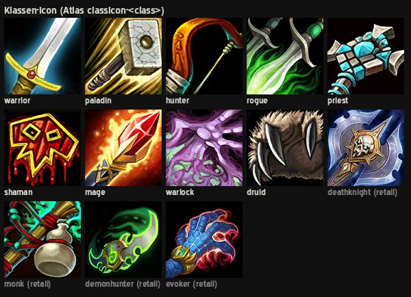

Quadratisches Klassen-Icon (128 px, Textur 1662186). Blizzard holt es über `GetClassAtlas()` (SharedConstants.lua),
z. B. für Schadensanzeige und Kommentator. Gleiches Motiv wie die Icon-Dateien unten, nur größer.
**Passt**, weil es ohne Rahmen auf einer flachen Fläche liegt; rund maskiert oder mit 1-px-Rand.

### 1.2 Klassen-Icons als Datei `Interface/Icons/ClassIcon_<class>` · **gut**
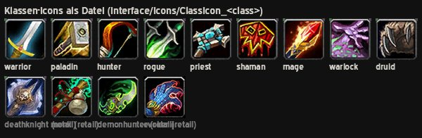

64 × 64, FileDataIDs 626000–626008 / 625999 (aus `ChrClasses.IconFileDataID`). Das ist das Symbol der einen
Pseudo-Spezialisierung pro Klasse in Forever. Mit 8 % Beschnitt und 1-px-Rand sieht es aus wie jedes andere mUI-Icon.

### 1.3 Runde Spieler-Portrait-Icons `ui-hud-unitframe-player-portrait-classicon-<class>-2x` · **gut**
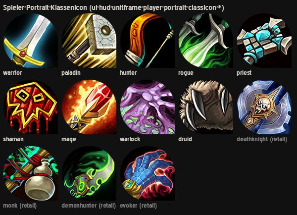

120 px, bereits rund. In der Forever-Lua nicht benutzt, aber vorhanden. **Am besten für ein kleines rundes Wappen**
(16–36 px) im Spielerrahmen oder im Fensterkopf.

### 1.4 Gruppensuche-Symbole `groupfinder-icon-class-*` · **gut**
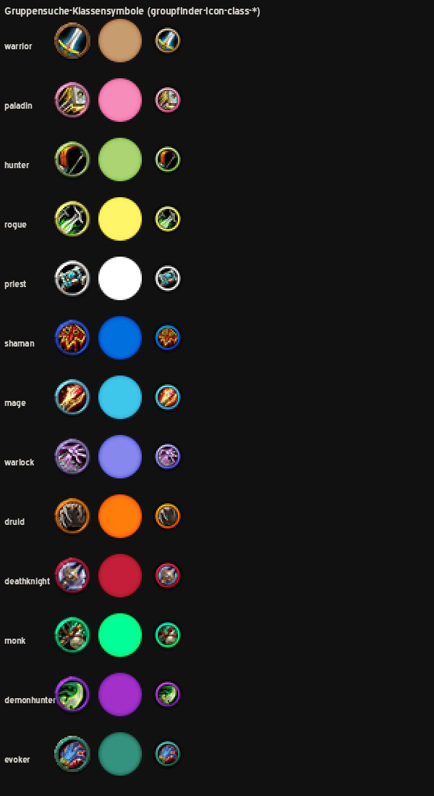

Drei Varianten: rundes Icon mit dünnem Ring in Klassenfarbe (29 px), reine Farbscheibe (`-color-`, 30 px),
und die kleinere Forever-Fassung `-c60` (22 px). Blizzard nutzt sie in der Gruppensuche (`Blizzard_GroupFinder_VanillaStyle`).
**Ideal als Inline-Icon** in Listen und Tooltips.

### 1.5 Alte Charaktererstellungs-Icons `UI-CharacterCreate-Classes` · **gut**
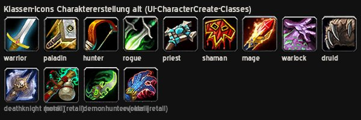

Eine 256er-Textur (131146), Ausschnitte über `CLASS_ICON_TCOORDS`. Das „klassischste“ Set; Blizzard nutzt es im
Schlachtzugsfenster, in der Gildenliste und im Kalender. mUI nutzt die Koordinaten schon in `Skins/Communities.lua`.

### 1.6 Klassische Klassen-Kreise `UI-Classes-Circles` · **ok abgedunkelt**
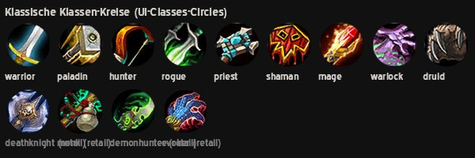

Gleiche Koordinaten, aber mit eingebackenem Goldring (237669, Kopie in ArenaEnemyFrame 574592). Der Ring beißt sich etwas mit dem 1-px-Stil.

### 1.7 Schlachtfeld-Tabelle `Icons-Classes` · **ok abgedunkelt**
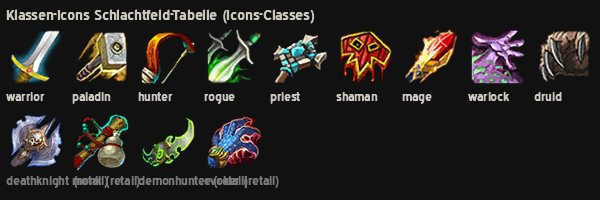

Kleine, detailarme Icons (137221) für Punktetabellen. Nur bei 16 px brauchbar.

### 1.8 Ordenshallen-Wappen `classhall-circle-<class>` · **ok abgedunkelt**
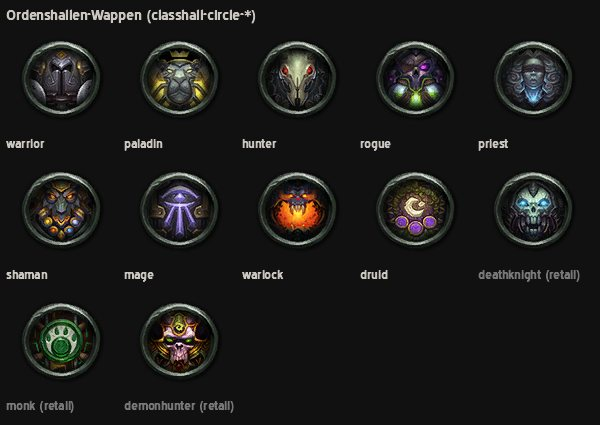

Dunkles Wappen mit Steinring (90 px), aus der Legion-Ordenshalle. Stark, aber klein schnell unruhig.

### 1.9 Klassentest-Ring `classtrial-<class>-ring` · **ok abgedunkelt**
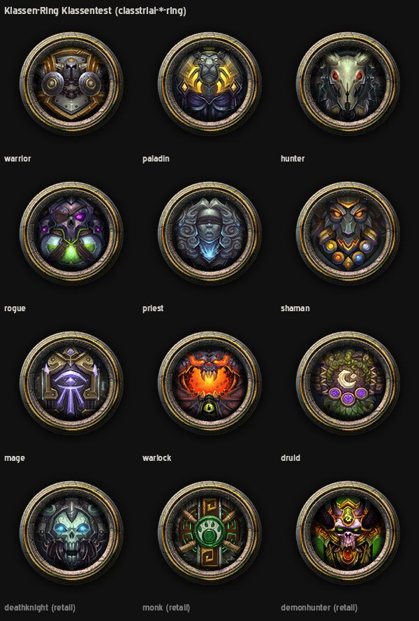

Dasselbe Wappen mit Goldring, 188 px (Blizzard_ClassTrial). Für **einen** großen Moment (Willkommen), sonst zu laut.

### 1.10 Missions-Icons `garrmission_classicon-<class>[-<spec>]` · **gut**
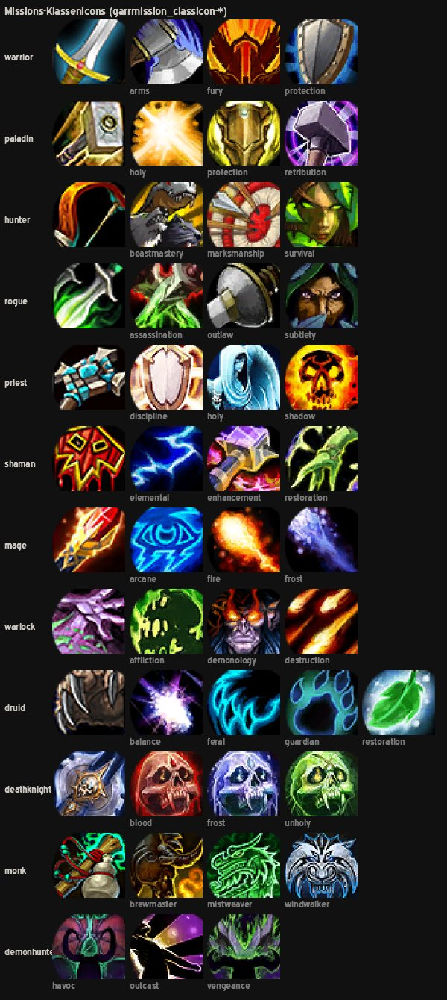

Abgerundete Klassen- und Spec-Icons (55 × 49) aus Garnison/Ordenshalle. Einziges Set mit einem Icon pro Baumname
(Waffen, Furor, Heilig …). Achtung: Retail-Namen wie *outlaw* oder *guardian* passen nicht 1:1 zu den Forever-Bäumen.

### 1.11 Alte Mikromenü-Knöpfe `UI-MicroButton-<Class>` · **schlecht**
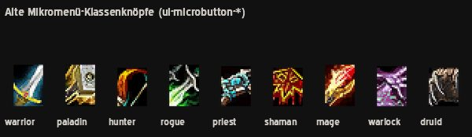

Knopfgrafik mit Fase aus Cataclysm. Passt nicht zum flachen Stil.

### 1.12 Freigestellte Klassen-Wappen (bronze und gold) · **gut** ★
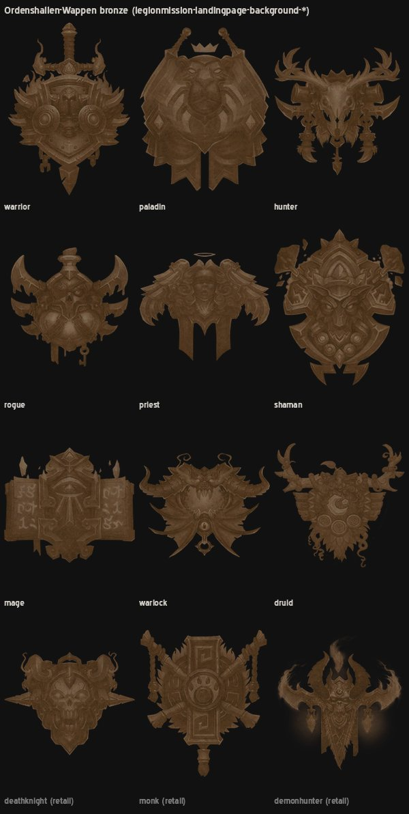
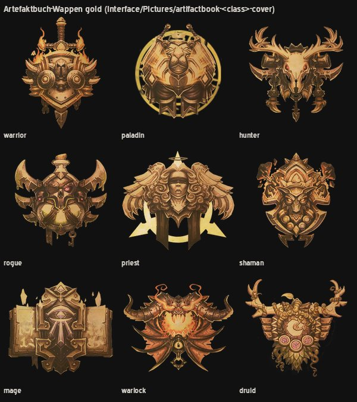

- `legionmission-landingpage-background-<class>`: einfarbiges Bronze-Wappen (ca. 200 × 250, Textur pro Klasse, z. B. 1389455)
- `Interface/Pictures/ArtifactBook-<Class>-Cover`: dasselbe Motiv in Gold, 256 × 256 (1450632–1450639)
- Die Motive stecken (sehr dunkel) auch im `-c60`-Charakterhintergrund und im Talent-Aktivierungseffekt.

Herkunft: Legion (Ordenshalle, Artefaktbücher), in Forever nicht benutzt. Weil sie **freigestellt und einfarbig** sind,
kann man sie entsättigen und mit dem Akzent tönen. Bei 15–22 % Deckkraft werden sie zu einem ruhigen, flachen Wasserzeichen:

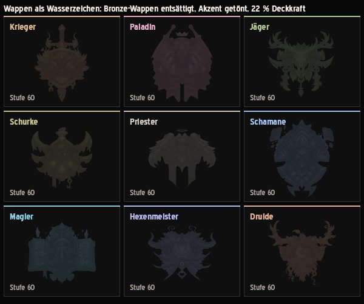

## 2. Talente, Bäume, Spezialisierungen

### 2.1 Forever-Talenthintergrund `talent-background-<class>` · **ok abgedunkelt**
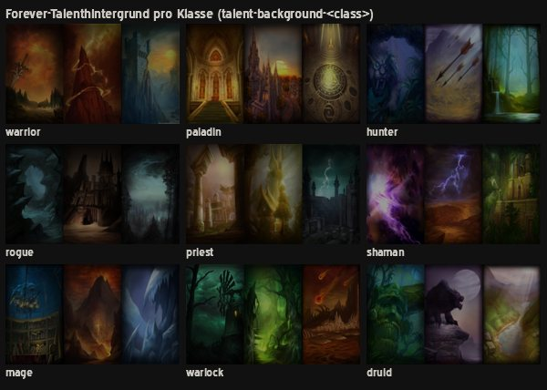

2046 × 1177, ein Panorama mit drei Zonen (eine pro Baum), z. B. Magier 7808140. Blizzard nutzt ihn im Forever-Talentfenster
(`Blizzard_PlayerSpells/Camelot/ClassTalents/Blizzard_ClassTalentUtil.lua`). **mUI nutzt ihn schon**: `Talents/Talents.lua`,
`TreeArt()` schneidet ihn in Drittel und dunkelt auf 50 % ab. Funktioniert nur abgedunkelt.

### 2.2 Klassische Talentbaum-Bilder `Interface/TalentFrame/<Klasse><Baum>-TopLeft/-TopRight/-BottomLeft/-BottomRight` · **ok abgedunkelt** ★
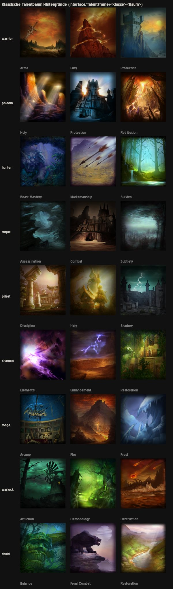

Die Originalbilder von 2004, eins pro Baum (27 Stück, je vier Teile: 256 × 256, 64 × 256, 256 × 128, 64 × 128).
Die Basisnamen stehen in Forevers `TalentTab.BackgroundFile` (z. B. `WarlockCurses`, `PaladinCombat`, `ShamanElementalCombat`).
Weich und dunkel. Bei 35–40 % Helligkeit **der klassischste Akzent pro Baum**, sauberer getrennt als das Panorama.

### 2.3 Talentbaum-Icons (`TalentTab.SpellIconID`) · **gut**
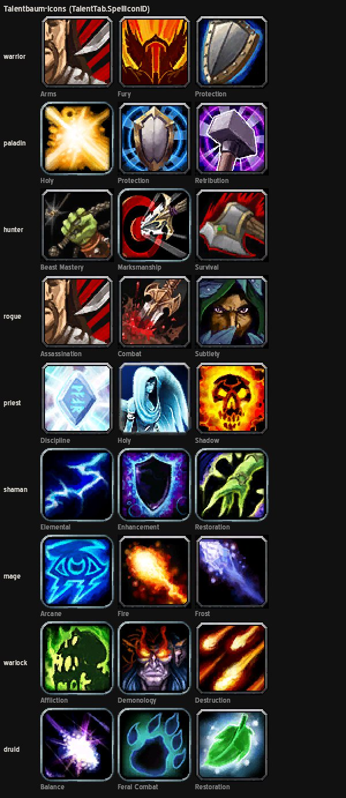

Die 27 Baum-Icons aus Forevers DB2. Quadratische Icons = mUIs eigener Icon-Stil, für Baum-Reiter und Überschriften.

### 2.4 Talent-Aktivierungseffekt `talents-animations-class-<class>` · **ok abgedunkelt**
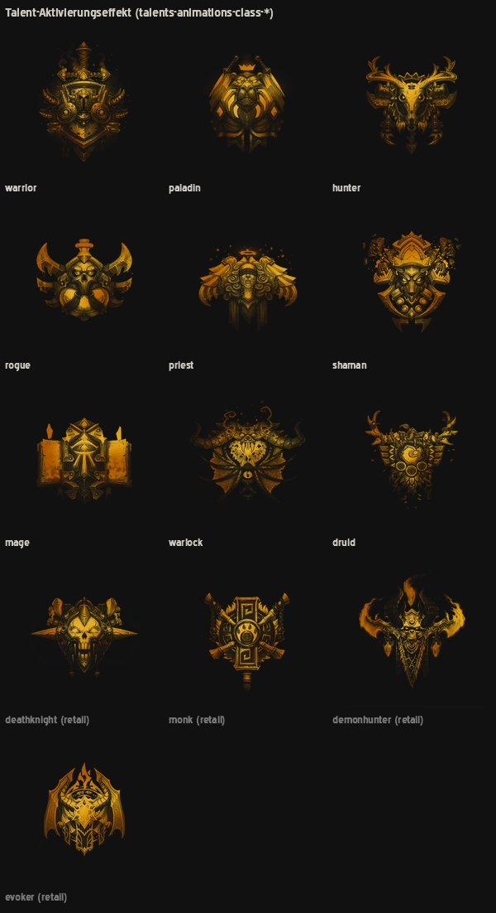

Goldenes Wappen (461 px), das Forever beim Übernehmen kurz aufblitzen lässt. Als Standbild hübsch, aber heller als die Bronze-Wappen.

### 2.5 Cataclysm-Spec-Bilder `Interface/TalentFrame/bg-<class>-<spec>` · **ok abgedunkelt**
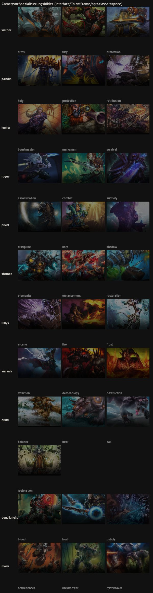

512 × 512, gemalte Szenen mit Figuren (Druide hat `bear`/`cat` getrennt). Bunt und unruhig, nur stark abgedunkelt.

### 2.6 Retail-Spec-Hintergründe `talents-background-<class>-<spec>` · **ok abgedunkelt** (Retail-System)
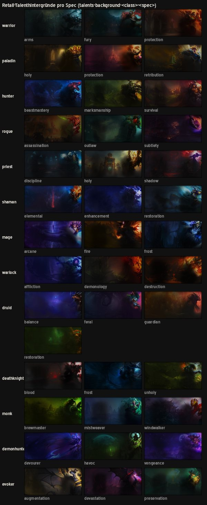

1612 × 774 aus Dragonflight. Retail-Spec-Namen passen nicht 1:1 zu den Forever-Bäumen.

### 2.7 Spec-Vorschaubilder `spec-thumbnail-<class>-<spec>` · **ok abgedunkelt** (Retail-System)
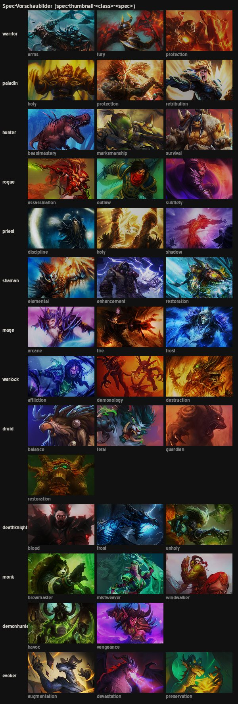

306 × 186, mit harter Rahmenkante. Höchstens als abgedunkelter Kartenkopf.

### 2.8 Ordenshallen-Talenthintergrund `orderhalltalents-background-<class>` · **ok abgedunkelt**
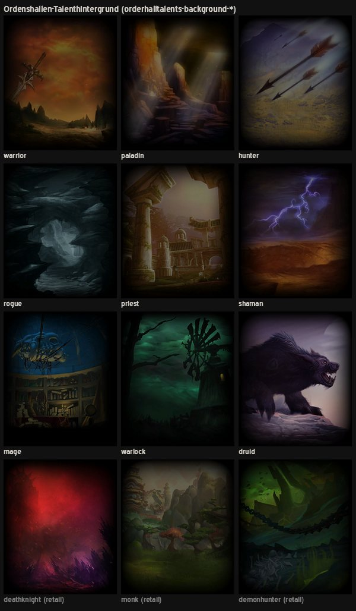

Hochformat 322 × 382, ähnliche Motive wie die klassischen Bäume. Als Seitenleisten-Bild denkbar.

## 3. Charakterfenster, Anprobe, Begleiter

### 3.1 Forever-Stats-Hintergrund `ui-character-info-<class>-bg-c60` · **gut** ★
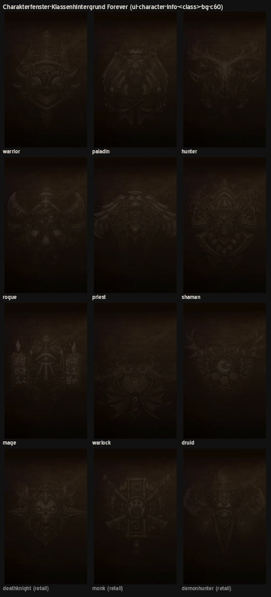

233 × 383 (Texturen 8175455/8175457, 2x-Fassung 8175459/8175461). Für Forever neu gemacht und von Blizzard hinter die
Werte im Charakterfenster gelegt (`Camelot/CharacterFrame.lua`: `UI-Character-Info-%s-BG`). Sehr dunkel und kontrastarm,
fast schon flach. **Das beste einzelne Asset für ein Klassen-Theme.**

### 3.2 Retail-Stats-Hintergrund `ui-character-info-<class>-bg` · **ok abgedunkelt**
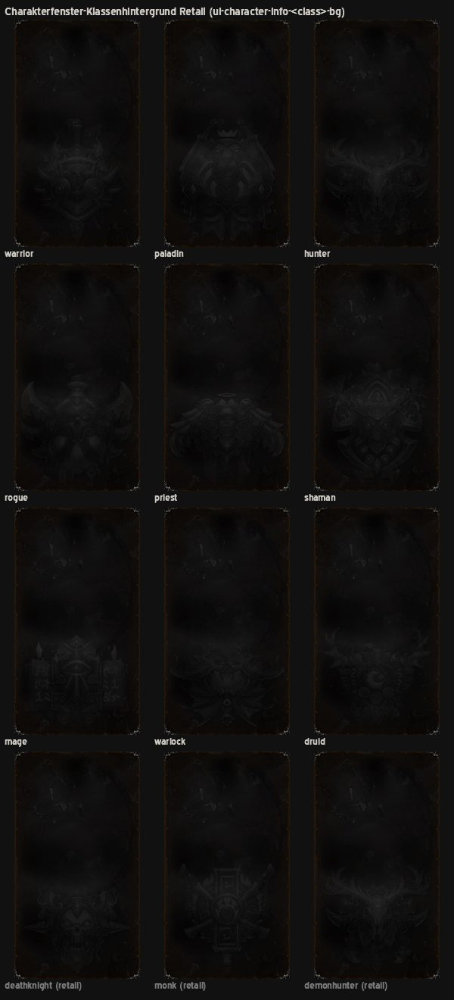

Legion-Fassung (197 × 355), farbiger als `-c60`.

### 3.3 Anprobe-Hintergrund `dressingroom-background-<class>` · **ok abgedunkelt**
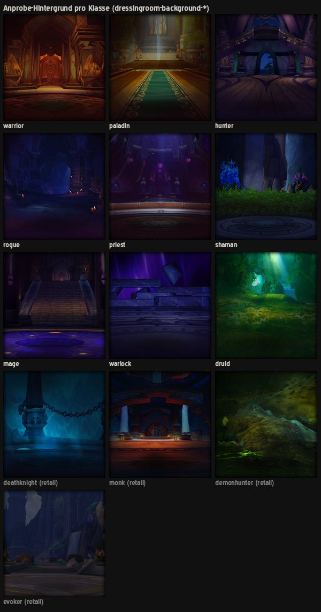

478 × 500, ganze Szene hinter dem Modell. `DressUpFrames.lua` (Mainline, in Forever geladen) wählt sie nach Klasse.
Hinter einem 3D-Modell bei ca. 40–45 % gut. mUI hat dort heute den Rassen-Hintergrund (`Char.RaceBackdrop`).

### 3.4 Begleiter-Hintergründe `PetStatsBG-<Class>`, `hunter-stable-bg-art_*` · **ok abgedunkelt**
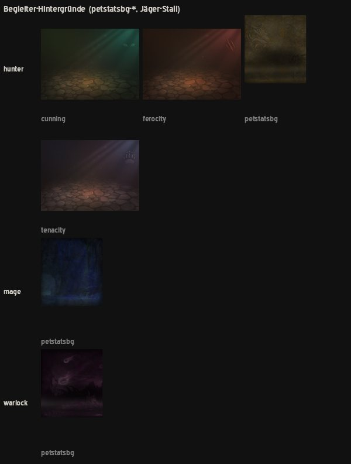

Nur Jäger/Hexer/Magier, bzw. Jäger-Stall pro Tierart. Für das Tier-Panel in `Character/Doll.lua` denkbar, sonst Nebensache.

## 4. Charaktererstellung (Glues)

`ChrClasses.CreateScreenFileDataID`/`SelectScreenFileDataID` sind in Forever 0, es gibt also **keine Klassen-Hintergründe
für Erstellung/Auswahl**. Die Forever-Glues (`glues-characterselect-*-c60`, `character-create-icon-*-c60`) haben keinen Klassenbezug.
Klassenbezogen sind nur die Icons aus 1.5 und diese:

### 4.1 Druidengestalten / Hexer-Begleiter `charactercreate-<class>form-*`, `charactercreate-<class>pet-*` · **gut**
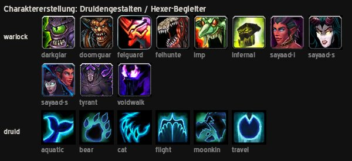

Runde, flache Icons (64 px) aus `Blizzard_CharacterCustomize`. Nur für zwei Klassen, z. B. als Akzent im Druiden-Gestaltwandel.

## 5. Zauberbuch, Lehrer, Legacy

- Das Forever-Zauberbuch (`spellbook-*-c60`) und das Legacy-System (`legacy-*-c60`, `ui-legacy-tree-*-c60`) haben **keine Klassenvarianten**.
- Die einzige Zauberbuch-Datei mit Klassennamen, `SpellbookBackgroundDruid` (5502842), ist ein 16 × 16-Platzhalter · **schlecht**.
- Lehrer-Fenster: nichts Klassenbezogenes vorhanden.

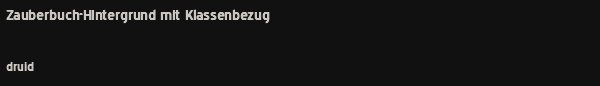

## 6. Klassenfarben

Blizzard-Werte aus `ChrClasses` (identisch mit `RAID_CLASS_COLORS`, `Blizzard_SharedXML/ClassColors.lua`).
Für den Akzent wurde jede Farbe in OKLCH auf **Helligkeit und Sättigung von Surf Green** gebracht, der Farbton bleibt.
So wirkt jede Klasse so ruhig wie das heutige mUI. Kontrast auf dem Panel (#0f0f10) liegt bei allen ≥ 9,7 : 1.

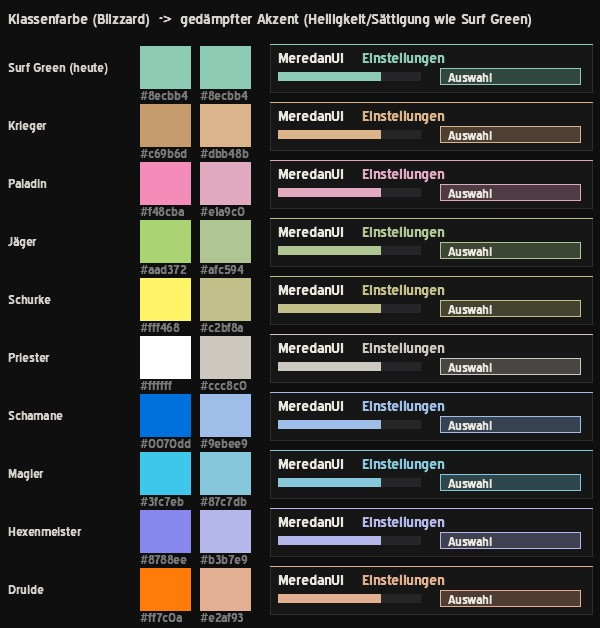

| Klasse | Blizzard | gedämpfter Akzent | Lua (0–1) | dunkle Tönung |
|---|---|---|---|---|
| Krieger | `#c69b6d` | `#dbb48b` | `{ 0.859, 0.706, 0.545 }` | `#4d3f31` |
| Paladin | `#f48cba` | `#e1a9c0` | `{ 0.882, 0.663, 0.753 }` | `#4f3b43` |
| Jäger | `#aad372` | `#afc594` | `{ 0.686, 0.773, 0.580 }` | `#3d4534` |
| Schurke | `#fff468` | `#c2bf8a` | `{ 0.761, 0.749, 0.541 }` | `#444330` |
| Priester | `#ffffff` | `#ccc8c0` | `{ 0.800, 0.784, 0.753 }` | `#474643` |
| Schamane | `#0070dd` | `#9ebee9` | `{ 0.620, 0.745, 0.914 }` | `#374252` |
| Magier | `#3fc7eb` | `#87c7db` | `{ 0.529, 0.780, 0.859 }` | `#2f464d` |
| Hexenmeister | `#8788ee` | `#b3b7e9` | `{ 0.702, 0.718, 0.914 }` | `#3f4052` |
| Druide | `#ff7c0a` | `#e2af93` | `{ 0.886, 0.686, 0.576 }` | `#4f3d33` |
| *(heute)* Surf Green | | `#8ecbb4` | `{ 0.557, 0.796, 0.706 }` | |

Priester bekommt ein warmes Hellgrau, weil Weiß keinen Farbton hat. Der Akzent sitzt zentral in `Config/Widgets.lua`
(`UI.ACCENT`). Die Akzentlinie der Fenster (`NPC/NpcWindow.lua`), Auswahlrahmen und Überschriften folgen ihm. Die
Chat-Marke „mUI“ (`Core/Core.lua`) sollte Surf Green bleiben, das ist das Logo.

## 7. Sonstiges mit Klassenbezug

### 7.1 Ordenshallen-Szenen `legionmission-complete-background-<class>` · **ok abgedunkelt**
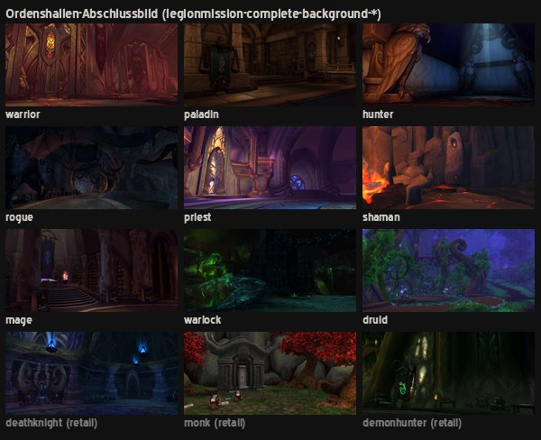

690 × 333, breite Hallen-Szenen. Abgedunkelt als Splash-Hintergrund denkbar, aber eindeutig Legion.

### 7.2 Ladebildschirme mit Klassenbezug · **ok abgedunkelt**
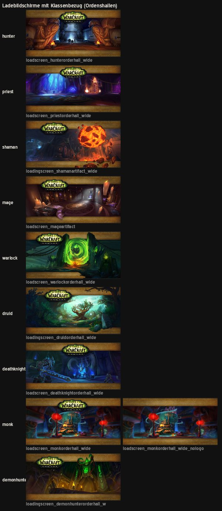

2048 × 1024, nur Ordenshallen/Artefakte und nur für 6 der 9 Klassen (Jäger, Priester, Schamane, Magier, Hexenmeister, Druide)
und mit eingebranntem Legion-Logo. **Nicht für alle Klassen nutzbar.**

### 7.3 Ordenshallen-Minimap-Knopf `legionmission-landingbutton-<class>-up` · **schlecht**
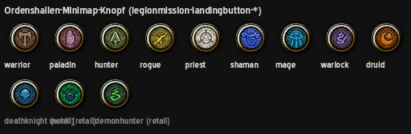

### 7.4 Artefakt-Kopfleisten `artifacts-<class>-header/-bg` · **schlecht**
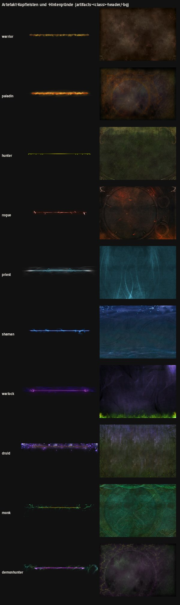

### 7.5 Forever-Kombopunkte `uf-roguecp-*-c60` · **ok abgedunkelt**
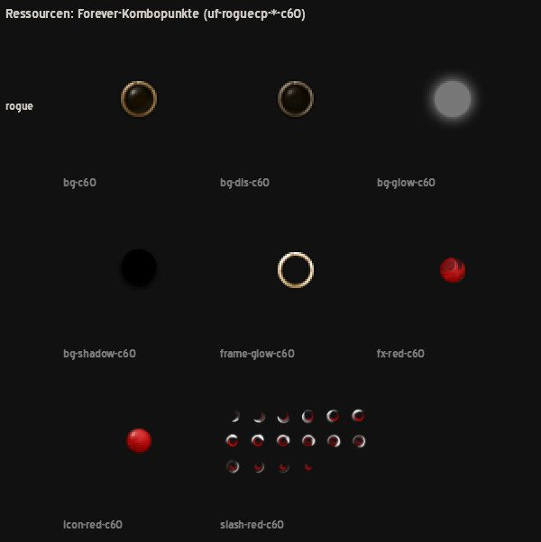

Rote Kombopunkt-Kugeln, für Forever neu gemacht (`RogueComboPoint.xml`). mUI zeichnet eigene flache Punkte, also nur als optionaler Skin.

### 7.6 Ressourcen-Texturen (Seelensplitter, Heilige Kraft, Finsternis, Arkanladungen, Mahlstrom …) · **schlecht**
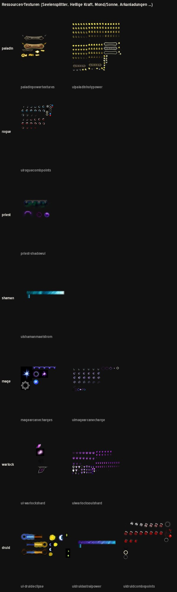

`Interface/PlayerFrame/*`, `Interface/HUD/*`. Detaillierte Retail-HUD-Grafik für Ressourcen, die es in Classic-Inhalten nicht gibt.

**Gilden-Rangwappen**: Im Client gibt es keine Rang-Wappen; nur Gilden-Wappen (Banner/Embleme) ohne Klassenbezug.

---

## Vorschläge für Plätze in mUI

| Ort in mUI | Datei | Vorschlag | Asset |
|---|---|---|---|
| Charakterfenster, Werte-Spalte | `Character/Stats.lua` (Werte), Fenster in `Character/Character.lua` | Hintergrund hinter den Werten, volle Deckkraft (ist schon dunkel) | `ui-character-info-<class>-bg-c60` |
| Charakterfenster, Kopf | `Character/Character.lua` (`UpdateHeader`), Kopf aus `NPC/NpcWindow.lua` | rundes Klassen-Icon 34 px mit 1-px-Akzentring neben dem Schließen-Knopf | `ui-hud-unitframe-player-portrait-classicon-<class>-2x` |
| Charakterfenster, Modell | `Character/Doll.lua` (`Char.RaceBackdrop`) | Option: Klassen-Szene statt Rasse, 40 % hell. Lieber beim Rassenbild bleiben (es ist schon gut) | `dressingroom-background-<class>` |
| Talentfenster, Bäume | `Talents/Talents.lua` (`TreeArt`) | im Klassen-Theme ein klassisches Bild pro Baum statt Panorama-Drittel, 35–40 % hell | `Interface/TalentFrame/<BackgroundFile>-*` |
| Talentfenster, Baumkopf | `Talents/Talents.lua` | Baum-Icon 20 px vor dem Baumnamen | `TalentTab.SpellIconID` |
| Zauberbuch | `Talents/Spellbook.lua` | getöntes Wappen klein in der rechten unteren Ecke der Pergamentfläche | `legionmission-landingpage-background-<class>` |
| Einstellungen | `Config/Options.lua` | Wasserzeichen-Wappen rechts im Kopf, Akzent in Klassenfarbe | Bronze-Wappen, getönt |
| Einrichtungs-Assistent | `Config/Setup.lua` (Intro, Logo ab Zeile ~529) | großes getöntes Gold-Wappen hinter dem Logo, 16 % | `ArtifactBook-<Class>-Cover` |
| Spielerrahmen | `UnitFrames/UnitFrames.lua` (`Style`, `unit == "player"`) | optional 16–20 px rundes Klassen-Icon links am Namen | Portrait-Klassenicon |
| Tooltip (Spieler) | `Tooltip/Tooltip.lua` | Inline-Icon vor der Zeile „Stufe … Klasse“ | `groupfinder-icon-class-<class>-c60` |
| AFK-Bildschirm | `AFK/AFK.lua` (untere Leiste) | kleines getöntes Wappen links neben dem Namen | Bronze-Wappen |
| Gildenfenster | `Skins/Communities.lua` | nutzt schon die klassischen Klassen-Icons, passt so | `UI-CharacterCreate-Classes` |
| Toasts | `Toasts/Toasts.lua` | nur Akzentfarbe, kein Bild (Toasts sollen klein bleiben) | – |
| Akzentfarbe | `Config/Widgets.lua` (`UI.ACCENT`) | im Klassen-Theme gedämpfte Klassenfarbe statt Surf Green | `accents.csv` |

Mockups (nur Spielgrafik + flache Flächen):

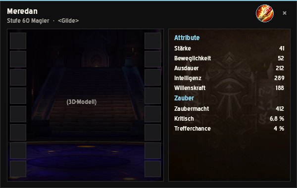
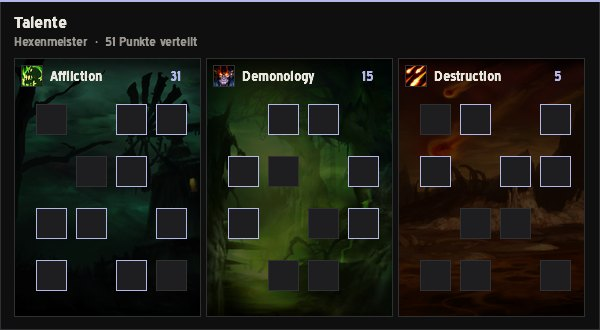
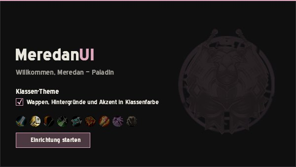
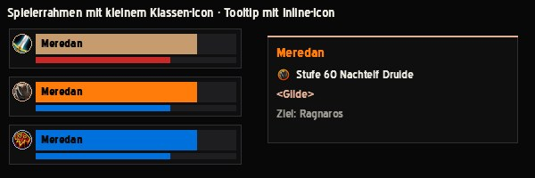

Hinweise zur Umsetzung (für später):
- Atlanten über `C_Texture.GetAtlasInfo()` holen, wie es `Talents/Talents.lua` schon tut. Fehlt ein Atlas, einfach die flache Fläche lassen.
- Ob Forever bei `UI-Character-Info-<CLASS>-BG` automatisch die `-c60`-Fassung nimmt, ist aus dem Quelltext nicht sicher zu sagen.
  Den Namen mit `-c60` direkt anzusprechen ist sicherer.
- Tönen im Spiel: `SetDesaturated(true)` + `SetVertexColor(akzent)` + `SetAlpha(0.15–0.22)`.
- Die klassischen Baumbilder sind 4 Teile; die sichtbare Fläche ist ca. 296 × 330 der zusammengesetzten 320 × 384.

## Top-Empfehlung

Höchstens diese sechs Dinge, alles hinter **einem** Schalter „Klassen-Theme“ (aus per Standard):

1. **Charakterfenster-Werte auf `ui-character-info-<class>-bg-c60`**: das Forever-eigene, sehr dunkle Klassenbild.
   Blizzard macht es genauso; kostet nichts und fällt nur leise auf.
2. **Gedämpfter Klassenakzent statt Surf Green** (`UI.ACCENT` in `Config/Widgets.lua`, Werte aus `accents.csv`): Akzentlinien,
   Auswahlrahmen und Überschriften bekommen die Klasse, die Ruhe bleibt.
3. **Ein großes Wappen im Einrichtungs-Assistenten** (`Config/Setup.lua`): Gold-Wappen `ArtifactBook-<Class>-Cover`,
   entsättigt, im Akzent getönt, 16 % Deckkraft hinter dem Logo. Der eine „starke Moment“.
4. **Getöntes Bronze-Wappen als Wasserzeichen** (`legionmission-landingpage-background-<class>`, 15–22 %) im Kopf der
   Einstellungen (`Config/Options.lua`) und klein im Zauberbuch (`Talents/Spellbook.lua`). Nicht mehr Stellen als diese.
5. **Talentfenster mit klassischem Bild pro Baum** (`Interface/TalentFrame/<BackgroundFile>-*`, 35–40 % hell) und dem
   Baum-Icon im Kopf (`Talents/Talents.lua`). Ohne Theme bleibt das heutige Panorama.
6. **Kleines rundes Klassen-Icon** (`ui-hud-unitframe-player-portrait-classicon-<class>-2x`) im Kopf des Charakterfensters,
   optional im Spielerrahmen; im Spieler-Tooltip das Mini-Icon `groupfinder-icon-class-<class>-c60`.

Bewusst **nicht** empfohlen: Ladebildschirme (nicht für alle Klassen, Legion-Logo), Ressourcen-Grafik, Mikromenü-Knöpfe,
Artefakt-Leisten, Cataclysm-/Retail-Spec-Bilder (bunt, Spec-Namen passen nicht).

## Nur Retail (nicht empfehlen)

Keine dieser Dateien fehlt im Client. Sie gehören aber zu Klassen oder Systemen, die es in Forever nicht gibt:

- **Klassen**: alle Varianten für Todesritter, Mönch, Dämonenjäger und Rufer (in `inventory.csv` mit `n/a (class not in Forever)`).
  Auch der Atlas `talent-background-*` hat in Forever nur 9 Einträge; Talentbilder `deathknight*` in `Interface/TalentFrame` sind Altlasten.
- **Heldentalente**: `talents-heroclass-<class>-<hero>` (z. B. `talents-heroclass-druid-eluneschosen`).
- **Retail-Spezialisierungen**: `talents-background-<class>-<spec>`, `spec-thumbnail-<class>-<spec>`, Spec-Namen wie *outlaw*, *guardian*, *devourer*.
- **Ordenshalle / Garnison**: `classhall-circle-*`, `legionmission-*`, `orderhalltalents-background-*`, `garrmission_classicon-*`, Ordenshallen-Ladebildschirme, `garrbuilding_magetower*`.
- **Artefakte**: `artifacts-<class>-*`, Artefaktbuch-Bilder der Waffen (`ArtifactBook-<Class>-<Waffe>`).
  Die **Cover** selbst sind trotzdem als neutrales Wappen brauchbar (siehe oben).
- **Retail-Ressourcen**: Heilige Kraft, Seelensplitter als Leiste, Arkanladungen, Mahlstrom, Wahnsinn, Astrale Macht, Finsternis
  (`Interface/HUD/UI*`, `Interface/PlayerFrame/*`, `unit_<class>_*`).
- **Shop / Sonstiges**: `shop-*`, `campcollection-*`, Warfront-Assets, Dastardly Duos.
